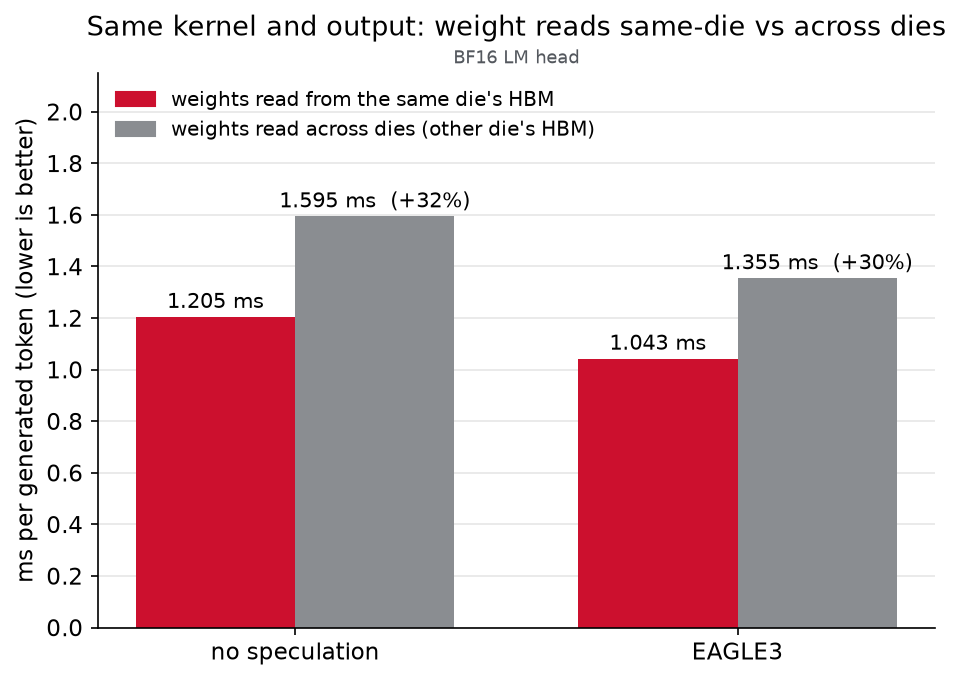
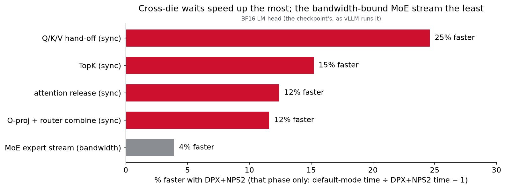
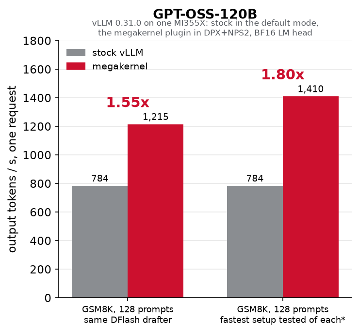
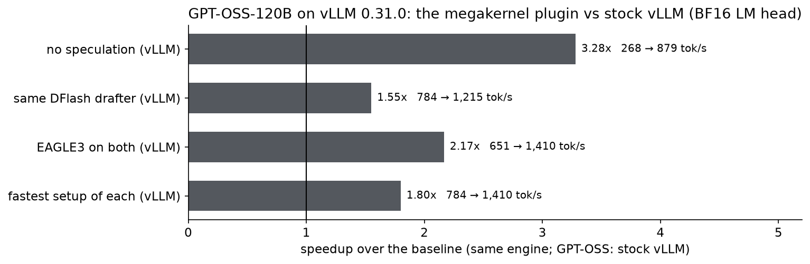

# GPT-OSS-120B blog numbers on the latest code, and how to reproduce each

This page covers every GPT-OSS-120B number and figure in the blog draft "Bringing ultra-fast inference to AMD
Instinct GPUs" (blog_b_qwen27b_dflash2_megakernel_DRAFT.docx, as of Oct 18 2026). It gives each value as measured again on
the latest code (Oct 18 2026), with **vLLM 0.31.0 on both sides** of every served comparison, and the command behind
it. The draft's GPT-OSS numbers were measured Oct 13-16 with vLLM 0.27.1 and the megakernel's own MXFP4 LM head.

**Every number is given for both LM heads, the BF16 one first.** Stock vLLM runs gpt-oss-120b's LM head in BF16, as
the checkpoint stores it. The megakernel's released builds re-quantize it to MXFP4, which reads 0.32 GB per token
instead of 1.19 GB. With the checkpoint's BF16 head (`MPK_LM_BF16`) both sides run the LM head at the same precision,
so those numbers lead. The MXFP4-head numbers (the released builds, and the head behind the draft's numbers) follow.
The head changes the logits, so the two heads generate different texts. The remaining precision differences (MXFP4
attention projections, FP8 activations) are compared against vLLM running AMD's MXFP4 x FP8 checkpoint in
[PRECISION_MATCHED_COMPARISON.md](PRECISION_MATCHED_COMPARISON.md). The blog headlines the released MXFP4-LM-head
builds against stock vLLM and checks the result at that precision: the megakernel with the BF16 LM head against vLLM
with AMD's checkpoint (the first four rows below). The one command in section 1 reproduces the megakernel side with
`CONFIGS="ns_bf16 e3_bf16 df8_bf16"`.

## Summary: blog draft vs latest code

| Blog statement | Draft | BF16 LM head | MXFP4 LM head | Section |
|---|---|---|---|---|
| Over vLLM at the same precision (AMD MXFP4 x FP8 checkpoint), no speculation | - | **3.5x** (248 -> 879) | - | 1 |
| Over vLLM at the same precision, EAGLE3 on both | - | **2.7x** (527 -> 1,410) | - | 1 |
| Over vLLM at the same precision, same DFlash drafter | - | **1.85x** (657 -> 1,215) | - | 1 |
| Over vLLM at the same precision, fastest setup of each | - | **2.1x** (657 -> 1,410) | - | 1 |
| Served tok/s on GSM8K-128, best setup | 1,451 | **1,410** | 1,484 (same builds); 1,472 (released 32K builds) | [1](#1-served-gsm8k-128-on-vllm-0310) |
| Over stock vLLM, no speculation | 3.6x (268 -> 964) | **3.28x** (268 -> 879) | 3.71x (994); 3.61x (966) | 1 |
| Over stock vLLM, EAGLE3 on both | 2.6x (562 -> 1,451) | **2.17x** (651 -> 1,410) | 2.28x (1,484); 2.26x (1,472) | 1 |
| Over stock vLLM, same DFlash drafter | 2.0x (615 -> 1,222) | **1.55x** (784 -> 1,215) | 1.60x (1,258); 1.58x (1,236) | 1 |
| Fastest setup of each | 2.4x (615 -> 1,451) | **1.80x** (784 -> 1,410) | 1.89x (1,484); 1.88x (1,472) | 1 |
| DFlash per round: tokens, ms | 4.25, 3.52 (stock 4.43, 7.20) | **4.26, 3.56** (stock **4.43, 5.65**) | 4.25, 3.43; 4.25, 3.52 | 1 |
| EAGLE3 per round: tokens, ms | 3.52, 2.46 | **3.50, 2.52** | 3.53, 2.41; 3.53, 2.46 | 1 |
| EAGLE3 pass vs DFlash pass | ~30% shorter | **29% shorter** | 30% shorter | 1 |
| Placement alone, single stream, 1K-32K generated | 7.5-10% faster | **4.3-8.2%** (6.5-8.2% up to 16K) | 7.5-8.2% | [2](#2-data-placement-dpxnps2-vs-the-default-mode) |
| With the speculative path (EAGLE3, 1 draft) | 16-20% faster | **24-30% up to 8K**; -0.4% and +5.7% at 16K and 32K (from ~8.5K to ~20K tokens the text repeats one token) | 16-20% (16.2-19.9%) | 2 |
| Weights read across dies (same output) | +28% (1.06 -> 1.36 ms), EAGLE3 +28% | **+32%** (1.205 -> 1.595 ms), EAGLE3 **+30%** (1.043 -> 1.355) | +28% (1.071 -> 1.367), EAGLE3 +27% (0.981 -> 1.247) | 2 |
| Critical path: extra time per layer in the default mode | 1.8 us, 85% data / 15% waiting | **1.65 us, 83% data / 17% waiting** | 1.43 us, 86% / 14% | [3](#3-per-phase-and-critical-path) |
| Per phase: Q/K/V hand-off, TopK, attention release, O-proj combine, MoE stream | 27 / 16 / 14 / 14 / 6% faster | **25 / 15 / 12 / 12 / 4%** | 25 / 17 / 11 / 11 / 4% | 3 |
| GSM8K: placement x speculation | ~1.1x x ~1.3x = ~1.4x | **1.08x and 1.23x, together 1.30x** | 1.08x and 1.27x, together 1.36x | [4](#4-gsm8k-and-the-1k-conversation-placement-and-speculation-outside-vllm) |
| Draft length: math rewards longer drafts, dense conversation one draft | stated | **GSM8K: 3 drafts 0.96 vs 1 draft 0.98 ms/token (3 drafts lose on question 3); 1K conversation: 1 draft 1.04 vs 3 drafts 1.14** | GSM8K: 3 drafts 0.81 vs 1 draft 0.93; conversation: 1 draft 0.98 vs 3 drafts 1.28 | 4 |
| Experts read per layer by a 4-token vs 2-token pass | 11.7 vs 7 | **11.6 vs 6.9** | 11.7 vs 6.9 | [6](#6-die-crossings-and-expert-unions) |
| Share of reads crossing dies in the default mode | about half | **50%** (49.8-50.5% from 1K to 32K context) | 50% (49.9-50.3%) | 6 |

In the MXFP4 column, "same builds" are the BF16 rows' builds with the MXFP4 head, served in the same session; the
released 32K builds are the configuration the draft measured. The stock vLLM side moved more than the megakernel:
from 0.27.1 to 0.31.0 its DFlash went from 615 to 784 tok/s (shorter steps, same acceptance), and its best EAGLE3
setting is now five drafts (651; three drafts give 582).

## Code, hardware and software

| | |
|---|---|
| Plugin and provider | this tree (`aitermk/`) |
| Megakernel source and exporter | github.com/sangeeta0201/fleet-chiplet-megakernel, branch `gpt-oss-120b-mi355x`: the megakernel with the opt-in BF16 LM head, the provider exporter, and the `scripts/nps2/blog/` and `scripts/nps2/fair/` scripts |
| Served builds | BF16 rows and their MXFP4 arm: the megakernel repository's own plugin (`vllm_integration/`), builds sized for these requests (the longest prompt + 264 tokens). MXFP4 32K rows: the released 32K-token exports (`ns`, `eagle3_b6`, `dflash_b8`) through this repository's provider |
| GPUs | MI355X, stock amdgpu 6.16.13 (srcversion CEAB5639AA71CAA0934A209), 1,400 W cap, Linux 6.8.0-136, host ROCm 7.2.0. DPX+NPS2 runs: one MI355X node, the GPU at HIP devices 12 and 13. Default-mode runs and the stock vLLM baseline: a second MI355X node (default mode = stock SPX+NPS1, the factory setting) |
| Served container | `vllm/vllm-openai-rocm:v0.31.0`: ROCm 7.2.3, torch 2.13.0, triton 3.8.0, AITER 0.1.23, transformers 5.17.0, Python 3.12.14 |
| Standalone runs (sections 2-4) | `vllm/vllm-openai-rocm:v0.27.1` containers on both nodes, for their ROCm 7.2.3 runtime only: these runs do not involve vLLM |
| Megakernel compiler | ROCm 7.0.0 (AMD clang 20.0.0git roc-7.0.0 25314) in every build, through `scripts/nps2/vllm/hip70/hipcc` |

The default-mode and DPX+NPS2 runs are on two nodes: the memory partition applies to all 8 GPUs of a node, and
the first node stays in DPX+NPS2 for other work. On one node, run one half, switch modes, run the other. An earlier
reproduction on a third node shows how much a node changes the numbers: DPX+NPS2 up to 0.8% slower and the default
mode up to 1.4% faster than on the first node. Read the locality percentages as +-1%.

## 1. Served: GSM8K-128 on vLLM 0.31.0

128 GSM8K prompts, one at a time, greedy, 256 output tokens with end-of-sequence ignored; output tokens per second
over all prompts (decode only: the megakernel processes the prompt token by token). Stock vLLM 0.31.0 on the same
128 prompts: 268 tok/s without speculation (1.00 tokens, 3.72 ms per step), 651 with NVIDIA's Eagle3-v3 head at 5
drafts (3.78 tokens, 5.80 ms), 784 with the same DFlash drafter at 7 drafts (4.43 tokens, 5.65 ms).

**How both sides are measured.** Both count every generated token after the first and exclude the prompt (the first
token comes from the prompt's last step), and both pool over the 128 prompts: all those tokens divided by all the
decode time. The megakernel's decode time is the client's wall clock from the first to the last streamed token of
each request through `vllm serve` (`gsm128_serve_bench.py`). Stock vLLM's is decode steps x the median measured step
time of each prompt, offline in one process (warm-up and tail steps left out of the median; `vllm_step_timing.py`,
`gsm128_vllm_summary.py`), so it carries no serving overhead. The time bases differ, and the difference favors stock
vLLM.

| Setup | Megakernel tok/s | Tokens per round | ms per round | TTFT | Over stock vLLM |
|---|---|---|---|---|---|
| **BF16 LM head** (two serves) | | | | | |
| No speculation | **879** (878, 880) | 1 | 1.14 | 183 ms* | **3.28x** |
| EAGLE3 (LMSYS head, up to 5 drafts, confidence-gated) | **1,410** (1,404, 1,416) | 3.50 | 2.52 | 71 ms* | **2.17x** |
| DFlash, 8-token block (7 drafts) | **1,215** (1,220, 1,211) | 4.26 | 3.56 | 63 ms* | **1.55x** |
| Fastest of each | 1,410 | | | | **1.80x** |
| **MXFP4 LM head, same builds and session** | | | | | |
| No speculation | 994 | 1 | 1.01 | 166 ms* | 3.71x |
| EAGLE3 | 1,484 | 3.53 | 2.41 | 68 ms* | 2.28x |
| DFlash | 1,258 | 4.25 | 3.43 | 61 ms* | 1.60x |
| Fastest of each | 1,484 | | | | 1.89x |
| **MXFP4 LM head, released 32K builds** | | | | | |
| No speculation | 966 | 1 | 1.04 | 139 ms | 3.61x |
| EAGLE3 | 1,472 | 3.53 | 2.46** | 64 ms | 2.26x |
| DFlash | 1,236 | 4.25 | 3.52** | 58 ms | 1.58x |
| Fastest of each | 1,472 | | | | 1.88x |

ms per round: the kernel's own pass times in each serve's log; without speculation 1000 / tok/s.

\* The builds sized for these requests print every pass's time at the end of each launch, which delays the next
request's start: their TTFT reads ~30 ms higher than a quiet build's (README: the quiet default cuts the
no-speculation TTFT from 168 to 137 ms). Decode rates are unaffected.

\*\* The released builds are quiet and print no pass times. These are the kernel's pass times from the Oct 17 serves
of the same builds on vLLM 0.31.0 and 0.27.1 (README). Today's tokens per round divided by today's served rate give
2.40 and 3.44 ms, which reads ~1.4% low (checked on Oct 16 logs that have both).

- The BF16 rows alternate with the MXFP4 arm in one session (BF16, MXFP4, BF16 per configuration). The two BF16 serves
  produced identical tokens for all 128 questions, and every streamed answer equals the kernel's own output arena
  (128/128). The BF16 head changes the logits, so its answers differ from the MXFP4 head's references
  (`scripts/data/gsm128_ref_*.json`) except on 14 / 2 / 1 of 128 questions. Both MXFP4 rows match those references
  128/128.
- Same builds and session, the BF16 head costs 11.6% without speculation, 5.0% with EAGLE3 and 3.4% with DFlash: it
  reads 1.19 GB per pass instead of 0.32 GB, and a speculative pass serves several tokens.
- The 32K EAGLE3 row is the second serve of that build, whose log has all 128 counter records. The first serve read
  1,468 tok/s, with the same tokens.
- The same build varies by 1-2% between server processes: the Oct 17 alternated serves of the 32K builds on vLLM
  0.27.1 and 0.31.0 read 959-977 / 1,451-1,454 / 1,222-1,224 tok/s.
- vLLM 0.31.0 with AMD's MXFP4 x FP8 checkpoint (matched attention precision as well) runs 248 / 527 / 657 tok/s. The
  BF16-head rows are 3.54x / 2.68x / 1.85x of it ([PRECISION_MATCHED_COMPARISON.md](PRECISION_MATCHED_COMPARISON.md)).

**Accepted tokens.** From the kernel's `[SPEC]` counters, one record per question; the bench's reruns of a question
repeat its counters exactly and count once. Tokens per round = (accepted drafts + rounds) / rounds, i.e. the accepted
drafts plus the target's own token.

| Setup | Questions | Rounds | Drafts proposed | Drafts accepted | Accepted share | Drafts per round | Tokens per round |
|---|---|---|---|---|---|---|---|
| **BF16 head, EAGLE3** (up to 5 drafts, stops below confidence 0.3) | 128 of 128 | 9,355 | 31,391 | 23,413 | **74.6%** | 3.36 | **3.50** |
| **BF16 head, DFlash** (7 drafts) | 128 of 128 | 7,696 | 53,019 | 25,072 | **47.3%** | 6.89 | **4.26** |
| MXFP4 head, EAGLE3, same builds | 127 of 128 | 9,216 | 31,367 | 23,296 | 74.3% | 3.40 | 3.53 |
| MXFP4 head, DFlash, same builds | 128 of 128 | 7,707 | 53,084 | 25,061 | 47.2% | 6.89 | 4.25 |
| MXFP4 head, EAGLE3, 32K builds | 128 of 128 | 9,295 | 31,649 | 23,473 | 74.2% | 3.40 | 3.53 |
| MXFP4 head, DFlash, 32K builds | 128 of 128 | 7,707 | 53,084 | 25,061 | 47.2% | 6.89 | 4.25 |
| Stock vLLM 0.31.0 EAGLE3, 5 drafts | 128 | | | | 55.6%* | 5 | 3.78 |
| Stock vLLM 0.31.0 EAGLE3, 3 drafts | 128 | | | | 69.8%* | 3 | 3.09 |
| Stock vLLM 0.31.0 DFlash, 7 drafts | 128 | | | | 49.0%* | 7 | 4.43 |

\* (tokens per step - 1) / drafts per step; stock vLLM proposes a fixed number of drafts every step.

Every question decodes 256 tokens, so each configuration's records add up to 32,768 tokens. Two logs lack the last
question's record: the MXFP4 EAGLE3 serve of the same-builds session (127 records, 32,512 tokens) and the first serve
of the 32K EAGLE3 build, whose 127 other records equal the second serve's. For the latter, this repository's bench
had stopped the server right after its one closing 1-token request; it now sends three. The MXFP4 head's two DFlash
serves (same builds, 32K builds) produce the same tokens and give identical counters. `blog_tab.py` (megakernel
repository) prints these tables; its parser rejoins counter lines that another process's output split in two in the
shared log.

**BF16 rows:** the one command below runs them with `CONFIGS="ns_bf16 e3_bf16 df8_bf16"` (with
`PROVIDERS` holding the BF16-LM-head exports `ns_bf16/ e3_bf16/ df8_bf16/` from the fleet repository's
`LM=bf16 ARENA=466 scripts/nps2/aitermk/exp_run.sh ns|e3|df8`). On Oct 19 it served 877 / 1400 / 1212 tok/s, every answer
token-identical to the Oct 18 serves. Those Oct 18 serves and their MXFP4 arm: in the megakernel repository,
`scripts/nps2/fair/serve_fair31.sh`. It runs
`fair_t1.sh`'s served sweep on a `vllm/vllm-openai-rocm:v0.31.0` container: each configuration as BF16, MXFP4, BF16,
through the megakernel's own plugin, results in `serve_fair31/`. That container also needs mirage's libz3 on its
library path and `pip install graphviz`, and `aitermk-fleet-vllm` must not be installed while it runs (both packages
publish the vLLM entry point `fleet_mk`; the script uninstalls this repository's adapter and reinstalls it at the end).
Then `python3 scripts/nps2/blog/blog_tab.py --served-bf <serve_fair31 dir> --served-bf-logs <its log dir> ...` prints
the BF16 and same-builds MXFP4 tables.

**MXFP4 32K rows:**

```bash
cd <this checkout>       # the repository root
CONTAINER=<a vllm/vllm-openai-rocm:v0.31.0 container> ROCM70=<ROCm 7.0.0 root, container path> \
CK_DIR=<composable_kernel checkout, container path> MODEL=<gpt-oss-120b checkpoint, container path> \
PROVIDERS=<the 32K exports: ns/ e3/ df8/> WORK=<work dir> DEVICES=12,13 N=128 PORT=8099 CONFIGS="ns e3 df8" \
  bash aitermk/engine_adapters/vllm/scripts/gpt_oss_build_and_repro.sh
```

`DEVICES` = the two HIP devices of one GPU in DPX+NPS2 (`scripts/nps2/dpx/to_dpx_nps2_stock.sh` in the megakernel
repository switches a node). The script builds the three providers, installs the adapter, serves each configuration
with `vllm serve` and checks every token. `python3 scripts/nps2/blog/blog_tab.py --served WORK/results` in the
megakernel repository prints the table.

**Stock vLLM 0.31.0** (SemiAnalysis's MI355X settings, offline, per-step GPU timing; one GPU per setup):

```bash
IMG=vllm/vllm-openai-rocm:v0.31.0 MODEL=<gpt-oss-120b> DFLASH=<z-lab/gpt-oss-120b-DFlash> \
EAGLE3=<nvidia/gpt-oss-120b-Eagle3-v3> GPUS=0,1,2,3 N=128 OUT=<dir> TAG=g128v31 \
  bash aitermk/engine_adapters/vllm/scripts/vllm_baseline/gsm128_vllm_baseline.sh
python3 aitermk/engine_adapters/vllm/scripts/vllm_baseline/gsm128_vllm_summary.py <dir>
```

Runs no speculation, DFlash with 7 drafts, and EAGLE3 with 3 and 5 drafts, on the same 128 prompt-token lists
(`scripts/data/gsm128_ref_ns.json`). Result: 268 / 784 / 582 / 651 tok/s (the second node, Oct 17 2026; the summary is
`scripts/nps2/blog/stock_vllm_031.json` in the megakernel repository). The LMSYS EAGLE3 head does not load in stock
vLLM, hence NVIDIA's `gpt-oss-120b-Eagle3-v3` there.

## 2. Data placement: DPX+NPS2 vs the default mode

The megakernel outside vLLM, 982-token prompt + N generated tokens, one request, the same code in both modes
(default mode: as deployed, without the per-die copies the stock driver cannot place). ms per generated token.
EAGLE3 does not run in the default mode as deployed (its 2-token verify pass needs the per-die barrier), so it is
compared with the default-mode single stream. Here EAGLE3 proposes one draft per pass.

**BF16 LM head:**

| Generated | Default mode | DPX+NPS2 | DPX+NPS2 faster | EAGLE3, 1 draft: ms/pass, tokens/pass, drafts accepted | EAGLE3 ms/token | EAGLE3 vs default single stream |
|---|---|---|---|---|---|---|
| 1K | 1.295 | 1.205 | 7.5% | 1.863, 1.785, 78.7% (450 of 572) | 1.044 | 24.1% |
| 2K | 1.319 | 1.219 | 8.2% | 1.862, 1.800, 80.0% (910 of 1,137) | 1.034 | 27.5% |
| 4K | 1.333 | 1.247 | 6.9% | 1.873, 1.825, 82.5% (1,851 of 2,243) | 1.026 | 29.9% |
| 8K | 1.351 | 1.268 | 6.5% | 1.906, 1.794, 79.4% (3,626 of 4,565) | 1.062 | 27.2% |
| 16K | 1.385 | 1.299 | 6.6% | 1.979, 1.424, 42.4% (4,876 of 11,507) | 1.390 | -0.4% |
| 32K | 1.418 | 1.359 | 4.3% | 2.095, 1.562, 56.2% (11,784 of 20,983) | 1.342 | 5.7% |

- Every default-mode output is identical to the DPX+NPS2 output of the same length. The 32K default-mode point was
  measured twice: 1.418 ms/token here and 1.427 in the counter run of section 6 (same output), i.e. 4.3% or 5.0%.
- Every EAGLE3 output is the model's own greedy output at EAGLE3's attention partition (15 KV chunks). The 1K run
  equals the 1K single stream at 15 KV chunks, the 32K run equals the 32K single stream at 15 KV chunks (1.390
  ms/token), and each shorter run equals the 32K run's first N tokens.
- **From 8K on, the BF16 head's text is one token repeated.** The prompt's answer ends at generated token 304; with
  end-of-sequence ignored the model repeats its summary, and from about 8,500 tokens it emits a single token over and
  over: a zero-width space (token 3310; the decoded windows at 9,000 and 12,000 are all of it), later " ..." (token
  2550, at 18,000 and 21,000), and text again by 30K. In 2K windows from 10K to 20K, 95-100% of the tokens repeat
  one of the previous eight. EAGLE3 accepts 18% of its drafts between 8K and 16K (1,250 of 6,942: the 16K run's
  counters minus the 8K run's, whose output is its prefix) and 73% between 16K and 32K, so its 16K and 32K rows
  measure that text. The single stream's time per token does not depend on the text.

**MXFP4 LM head:**

| Generated | Default mode | DPX+NPS2 | DPX+NPS2 faster | EAGLE3, 1 draft: ms/pass, tokens/pass, drafts accepted | EAGLE3 ms/token | EAGLE3 vs default single stream |
|---|---|---|---|---|---|---|
| 1K | 1.159 | 1.071 | 8.2% | 1.715, 1.749, 74.9% (438 of 585) | 0.981 | 18.2% |
| 2K | 1.167 | 1.086 | 7.5% | 1.716, 1.763, 76.4% (886 of 1,160) | 0.973 | 19.9% |
| 4K | 1.191 | 1.105 | 7.8% | 1.737, 1.743, 74.3% (1,745 of 2,350) | 0.997 | 19.5% |
| 8K | 1.211 | 1.125 | 7.6% | 1.774, 1.753, 75.3% (3,519 of 4,671) | 1.012 | 19.7% |
| 16K | 1.246 | 1.159 | 7.5% | 1.848, 1.764, 76.4% (7,098 of 9,285) | 1.047 | 19.0% |
| 32K | 1.310 | 1.214 | 7.9% | 1.986, 1.762, 76.2% (14,167 of 18,600) | 1.127 | 16.2% |

Every default-mode output is identical to the DPX+NPS2 output of the same length, and EAGLE3's 1K output is
identical to the single stream at its attention partition (15 KV chunks).

**Weights across dies** (same binary and output, `MPK_W_SWAP=1` stores every read-only weight in the other die's
memory), 1K. BF16 head: single stream 1.205 -> 1.595 ms/token (+32.4%), EAGLE3 1.043 -> 1.355 (+29.8%). MXFP4 head:
single stream 1.071 -> 1.367 (+27.6%), EAGLE3 0.981 -> 1.247 (+27.2%). The BF16 head's 1.19 GB is itself one of the
read-only weights moved, hence the larger cost.



## 3. Per phase and critical path

Phase recorder over the 1,024 generated tokens (1K run), mean over workers, scaled to each run's plain decode time,
us per token; faster = default-mode time / DPX+NPS2 time - 1.

| Phase | Kind | BF16: default | BF16: DPX+NPS2 | BF16: faster | MXFP4: default | MXFP4: DPX+NPS2 | MXFP4: faster |
|---|---|---|---|---|---|---|---|
| Q/K/V hand-off (QKV epoch) | sync | 35.1 | 28.2 | **24.6%** | 35.3 | 28.3 | 24.8% |
| TopK (8-die router sums, selection) | sync | 145.7 | 126.5 | **15.2%** | 148.3 | 126.4 | 17.3% |
| Attention release | sync | 123.1 | 109.5 | **12.4%** | 121.3 | 109.4 | 10.9% |
| O-proj + router combine | sync | 220.4 | 197.4 | **11.6%** | 218.7 | 197.4 | 10.8% |
| MoE expert stream | bandwidth | 329.6 | 317.3 | **3.9%** | 327.3 | 314.0 | 4.3% |
| Outside the layers (LM head, argmax, embedding) | | 211.9 | 206.6 | 2.5% | 80.5 | 76.4 | 5.4% |
| Whole token | | 1,295 | 1,205 | **7.5%** | 1,159 | 1,071 | 8.2% |



Critical path of pass 1500 (~1.5K context), default mode minus DPX+NPS2:
- BF16 head: a layer takes 31.12 us in the default mode and 29.47 us in DPX+NPS2, **+1.65 us**. Data segments
  account for +1.38 us (83%: MoE +0.84, attention +0.46, O-proj + router +0.28, QKV -0.20), synchronization for
  +0.28 us (17%: QKV epoch +0.25, attention release +0.25, TopK -0.18, layer boundary -0.05).
- MXFP4 head: 31.12 vs 29.69 us, +1.43 us. Data +1.24 us (86%: MoE +0.64, O-proj + router +0.45, attention +0.32,
  QKV -0.18), synchronization +0.19 us (14%: QKV epoch +0.27, attention release +0.18, TopK -0.16, layer boundary
  -0.10).

One snapshot of 36 layers per run; the LM head is outside the layers, so both heads' layer paths are the same code
(the two default-mode totals agree to two decimals by coincidence; their segments differ). The draft's 1.8 us came
from the Oct 13 code.

## 4. GSM8K and the 1K conversation: placement and speculation, outside vLLM

The method behind the draft's numbers (Oct 13), on GSM8K questions 1-3 of the bench prompts:
- The single stream generates 768 tokens. Its answer ends at the first `<|return|>` (questions 1 and 2; question 3
  runs past 768). Its time per token is averaged over the answer's tokens, from the per-pass trace.
- EAGLE3 with 1 draft then generates exactly that many tokens.
- EAGLE3 with 3 drafts runs on the 4-token engine, whose attention uses 7 KV chunks. It is compared with a single
  stream at 7 KV chunks, and generates that run's answer length.

Placement = default / DPX+NPS2 single stream; speculation = 7-chunk single stream / 3 drafts; together = default /
3 drafts. "All three" averages the time per token over all answer tokens. ms per generated token, DPX+NPS2 unless
marked.

**BF16 LM head:**

| Question | Answer | Default mode | DPX+NPS2 | Placement | 1 draft: tokens/pass, drafts accepted | 1 draft | 7-chunk single stream (answer) | 3 drafts: tokens/pass, drafts accepted | 3 drafts | Speculation | Together |
|---|---|---|---|---|---|---|---|---|---|---|---|
| 1 | 224 | 1.2267 | 1.1355 | 1.080x | 1.906, 106 of 117 (91%) | 0.9308 | 1.1542 (272) | 3.566, 195 of 228 (86%) | 0.8234 | 1.402x | 1.490x |
| 2 | 392 | 1.2432 | 1.1517 | 1.079x | 1.836, 178 of 213 (84%) | 0.9860 | 1.1728 (420) | 3.248, 290 of 387 (75%) | 0.9039 | 1.297x | 1.375x |
| 3 | 768+ | 1.2503 | 1.1615 | 1.076x | 1.822, 346 of 420 (82%) | 0.9979 | 1.1810 (768+) | 2.883, 501 of 798 (63%) | 1.0311 | 1.145x | 1.213x |
| All three | 1,384 | 1.2445 | 1.1545 | **1.078x** | | 0.9837 | 1.1736 (1,460) | | 0.9558 | **1.228x** | **1.302x** |

One draft gives 1.220x / 1.168x / 1.164x over the DPX+NPS2 single stream (1.174x all three). Every output is
identical to its reference: the default mode's 768 tokens to DPX+NPS2's, each 1-draft answer to the single stream,
each 3-draft answer to the 7-chunk single stream. The BF16 head writes longer answers than the MXFP4 head (224 / 392
tokens against 215 / 335; question 3 runs past 768 with both). Three drafts gain less with the BF16 head: speculation
1.23x instead of 1.27x, and on question 3 one draft is faster than three. Its 4-token verify pass takes 2.94-2.97 ms,
0.36-0.42 ms more than with the MXFP4 head (2.52-2.58), while its 1- and 2-token passes take only 0.13-0.15 ms more
(pass = ms/token x tokens per pass, here and in the conversation below).

**MXFP4 LM head:**

| Question | Answer | Default mode | DPX+NPS2 | Placement | 1 draft: tokens/pass, drafts accepted | 1 draft | 7-chunk single stream (answer) | 3 drafts: tokens/pass, drafts accepted | 3 drafts | Speculation | Together |
|---|---|---|---|---|---|---|---|---|---|---|---|
| 1 | 215 | 1.0926 | 1.0042 | 1.088x | 1.894, 101 of 112 (90%) | 0.8655 | 1.0204 (249) | 3.351, 174 of 221 (79%) | 0.7660 | 1.332x | 1.426x |
| 2 | 335 | 1.0812 | 1.0088 | 1.072x | 1.777, 146 of 188 (78%) | 0.9321 | 1.0239 (277) | 3.209, 190 of 255 (75%) | 0.8017 | 1.277x | 1.349x |
| 3 | 768+ | 1.1080 | 1.0210 | 1.085x | 1.780, 336 of 431 (78%) | 0.9429 | 1.0316 (492) | 3.108, 333 of 473 (70%) | 0.8305 | 1.242x | 1.334x |
| All three | 1,318 | 1.0987 | 1.0152 | 1.082x | | 0.9275 | 1.0268 (1,018) | | 0.8069 | 1.273x | 1.362x |

One draft gives 1.160x / 1.082x / 1.083x over the DPX+NPS2 single stream (1.094x all three). Every output is
identical to its reference, and all twelve DPX+NPS2 runs are token-identical to the Oct 13 runs behind the draft (and
to their repetition on another node), so only the times moved. Oct 13 read 1.0060 / 1.0137 / 1.0279 (single stream),
0.8644 / 0.9377 / 0.9469 (1 draft) and 0.7719 / 0.8045 / 0.8305 ms/token (3 drafts), and had no default-mode run.

**The 1K conversation** (982-token prompt + 1,024 generated, end of answer ignored, as in section 2), ms per
generated token, DPX+NPS2:

| Run | BF16: ms/pass | BF16: tokens/pass, drafts accepted | BF16: ms/token | MXFP4: ms/pass | MXFP4: tokens/pass, drafts accepted | MXFP4: ms/token |
|---|---|---|---|---|---|---|
| Single stream (section 2) | | 1 | 1.205 | | 1 | 1.071 |
| Single stream at 7 KV chunks | | 1 | 1.197 | | 1 | 1.054 |
| EAGLE3, 1 draft (section 2) | 1.863 | 1.785, 450 of 572 (78.7%) | **1.044** | 1.715 | 1.749, 438 of 585 (74.9%) | **0.981** |
| EAGLE3, 3 drafts | 2.940 | 2.577, 626 of 1,189 (52.6%) | 1.141 | 2.524 | 1.967, 503 of 1,557 (32.3%) | 1.283 |

One draft is the fastest with either head, as the draft says. The BF16 head's text accepts more of three drafts
(52.6% against 32.3%), so with it three drafts still beat no speculation (1.141 against 1.197 at 7 KV chunks); with
the MXFP4 head they do not (1.283 against 1.054). Each 3-draft output equals its 7-chunk single stream, 1,024 of
1,024 tokens. The MXFP4 pair is also token-identical to the Oct 14 runs behind the draft, on another node (1.2825
and 1.062 ms/token there).

## 5. Running the standalone half

In the megakernel repository (github.com/sangeeta0201/fleet-chiplet-megakernel, branch `gpt-oss-120b-mi355x`),
directory `scripts/nps2/blog/` (README there). `<tree>` is a checkout of that branch; the scripts expect the
container to mount your home directory, so give container paths where the commands below ask for them:

```bash
bash scripts/nps2/blog/setup_lane.sh <tree>        # a worktree, reusing built dependencies (or build per NPS2_NPS1_README.md)
bash scripts/nps2/dpx/to_dpx_nps2_stock.sh         # node to DPX+NPS2, stock driver (~3 min; to_nps1_stock.sh goes back)
cd <tree>/scripts/nps2/blog
CONTAINER=<ctr> PATH_PREPEND=<tree, container path>/scripts/nps2/vllm/hip70 BUS=e5 bash run_dpx.sh   # sections 2-3
# section 4, BF16 then MXFP4 LM head:
LM=bf16 TAG=bf CTAG=bfc GSM_OUT=<gsm_bf> DPX_LANE=<tree> DPX_BUS=e5 DPX_CONTAINER=<ctr> bash gsm8k/run_dpx.sh
GSM_OUT=<gsm_mx> DPX_LANE=<tree> DPX_BUS=e5 DPX_CONTAINER=<ctr> bash gsm8k/run_dpx.sh
#   on a node in the default mode, with its own worktree <tree2>:
CONTAINER=<ctr> PATH_PREPEND=<tree2, container path>/scripts/nps2/vllm/hip70 BUS=05 LANE=<tree2> bash run_default.sh
LM=bf16 TAG=bf GSM_OUT=<gsm_bf> DPX_LANE=<tree> DEF_LANE=<tree2> DEF_BUS=05 DEF_CONTAINER=<ctr> bash gsm8k/run_default.sh
GSM_OUT=<gsm_mx> DPX_LANE=<tree> DEF_LANE=<tree2> DEF_BUS=05 DEF_CONTAINER=<ctr> bash gsm8k/run_default.sh
# section 6 (needs run_default.sh's GSM8K runs and section 2's 1K EAGLE3 runs):
T=<tree>/demo/gpt_oss/blog_tokens
LM=bf16 TAG=bf UTAG=bfu GSM_OUT=<gsm_bf> SP1024_TOK=$T/tok_bl_dpx_spbf1024.json DPX_LANE=<tree> DEF_LANE=<tree2> \
  DEF_BUS=05 DEF_CONTAINER=<ctr> bash gsm8k/union.sh
GSM_OUT=<gsm_mx> SP1024_TOK=$T/tok_bl_dpx_sp1024.json DPX_LANE=<tree> DEF_LANE=<tree2> DEF_BUS=05 \
  DEF_CONTAINER=<ctr> bash gsm8k/union.sh
python3 blog_tab.py --dpx <run logs of <tree>> --default <run logs of <tree2>> \
  --served <WORK>/results --served-bf <serve_fair31 dir> --served-bf-logs <run logs of <tree>> \
  --charts charts_data.json
python3 gsm8k/table.py --out <gsm_bf> --tag bf --ctag bfc   # section 4, BF16
python3 gsm8k/table.py --out <gsm_mx>                       # section 4, MXFP4
python3 blog_charts.py charts_data.json charts/             # matplotlib
```

`run_dpx.sh` runs the groups `phase length swap` (MXFP4 and BF16 phase runs, MXFP4 lengths and swap; about 20 min)
and `lengthbf swapbf ckbf` (BF16 lengths, swap, and the 32K single stream at 15 KV chunks; about 19 min).
`run_default.sh` runs `phase length` (about 9 min) and `lengthbf` (about 8 min). `gsm8k/run_dpx.sh` takes about 13
min per head, `gsm8k/run_default.sh` 2 min, `gsm8k/union.sh` 4 min. All refuse to run unless the GPU is in their
mode on the stock driver, and the DPX+NPS2 ones by default wait while any other process uses a GPU. `LM=bf16`
switches a run to the BF16 head: the BF16 variables (`MPK_LM_BF16=1` and the MXFP4 head's pipelines off) plus
`-DMPK_LM_BF16` appended to the run's own `MPK_EXTRA_FLAGS`. `DRY=1` prints each run's environment instead of running
it. The BF16 runs of sections 2-3 ran through `run_dpx.sh` and `run_default.sh` themselves; for the MXFP4 runs,
`dry_check.py` compares the printed environments with those recorded in the run logs, and all 16 recorded
compositions match. `gsm8k/specg.sh` with `DRY=1` reproduces the environment and arguments of all 42 runs behind
sections 4 and 6 (both heads) exactly.

## 6. Die crossings and expert unions

- **About half of all reads cross dies in the default mode: 50% with either head.** The GPU's data-fabric counters
  (die-to-die and HBM read traffic) over one default-mode decode (982-token prompt + 32,768 generated, one MI355X in
  stock SPX+NPS1, Oct 18 2026), per forward pass at each context:

  | Context | BF16: HBM read per pass | BF16: read across dies | BF16: share | MXFP4: HBM read per pass | MXFP4: read across dies | MXFP4: share |
  |---|---|---|---|---|---|---|
  | 1K | 3,860 MB | 1,933 MB | 50.1% | 2,927 MB | 1,471 MB | 50.3% |
  | 2K | 3,896 MB | 1,946 MB | 49.9% | 2,959 MB | 1,489 MB | 50.3% |
  | 4K | 3,966 MB | 1,994 MB | 50.3% | 3,046 MB | 1,530 MB | 50.2% |
  | 8K | 4,116 MB | 2,066 MB | 50.2% | 3,205 MB | 1,604 MB | 50.0% |
  | 16K | 4,457 MB | 2,227 MB | 50.0% | 3,523 MB | 1,765 MB | 50.1% |
  | 32K | 5,038 MB | 2,507 MB | 49.8% | 4,106 MB | 2,049 MB | 49.9% |

  Over the whole decode: BF16 50.3% (2,215 of 4,404 MB per pass), MXFP4 50.4% (1,755 of 3,486 MB); the BF16 head
  adds ~0.9 GB of reads per pass. The BF16 run decoded at 1.427 ms/token and the MXFP4 run at 1.301, each with the
  same output as section 2's 32K run of its head. The Sep 28 measurement on older code read 49.6-50.1%, and in NPS2
  0.9-1.2% from 1K to 32K context (not repeated). The counter tool and its configuration are internal to AMD and
  not part of this repository; the numbers are given for reference.
- **Experts per layer: 11.6 for a 4-token pass, 6.9 for 2 (BF16 head; 11.7 and 6.9 with the MXFP4 head).** The
  reference (torch) model's router top-4 at every position of a generated text, then the number of distinct experts
  per layer over every window of B consecutive tokens (`scripts/nps2/spec/dflash/union_study.py`, pooled over eight
  texts), U(1..10):
  - BF16 head: 4.00, 6.92, 9.44, 11.63, 13.63, 15.45, 17.14, 18.71, 20.18, 21.57. Texts: GSM8K questions 1-3,
    HumanEval 1-2 and MT-Bench 1-2 in the default mode (first 384 generated tokens, cut at the end of the answer:
    224 / 384 / 384 / 384 / 384 / 384 / 282 tokens), and the 1K conversation's 1,024 tokens from section 2's 1-draft
    EAGLE3 run. Per text, U(4) ranges from 10.71 (MT-Bench 1) to 12.20 (GSM8K question 3), and consecutive tokens
    share 0.94-1.42 experts.
  - MXFP4 head: 4.00, 6.93, 9.46, 11.66, 13.66, 15.49, 17.18, 18.76, 20.24, 21.65, on the same prompts (215 / 335 /
    384 / 384 / 384 / 384 / 295 tokens and the 1K conversation). All eight texts are token-identical to the Oct 12
    texts behind the draft's numbers, so the result is the same to the last digit. Per text, U(4) ranges from 10.74
    (MT-Bench 1) to 12.22 (GSM8K question 3), and consecutive tokens share 0.93-1.37 experts.

  Independent picks would give 7.88 for 2 and 15.27 for 4: consecutive tokens share about one expert in four.

## 7. Charts

`blog_charts.py` draws all figures from the data file `blog_tab.py --charts` writes, in the draft's style, with the
BF16 LM head (the MXFP4 values are in sections 1-3):

| Draft figure | Redrawn |
|---|---|
| GPT-OSS panel of the speed figure | [docs/blog/gptoss_speed.png](docs/blog/gptoss_speed.png) |
| Weights same die vs across dies | [docs/blog/weights_same_vs_cross.png](docs/blog/weights_same_vs_cross.png) |
| Per-phase speedup | [docs/blog/phase_speedup.png](docs/blog/phase_speedup.png) (both heads: [docs/blog/phase_speedup_lm.png](docs/blog/phase_speedup_lm.png)) |
| GPT-OSS rows of the cross-workload figure | [docs/blog/gptoss_speedups.png](docs/blog/gptoss_speedups.png) |





## 8. Text in the draft that changes

With the BF16 LM head, the fair comparison (the MXFP4 head's values in brackets):

- Highlights: "GPT-OSS-120B: up to 1,410 tokens/s on GSM8K, 1.8x the fastest stock vLLM setup we tested (different
  partition mode and drafter), and 1.55x with the same drafter on both sides." [1,472 tokens/s, 1.9x and 1.6x]
- Spatial locality: "...makes GPT-OSS-120B decode 4-8% faster from data placement alone, and 24-30% faster with the
  speculative path enabled in this build (up to 8K generated tokens)." [7.5-8% and 16-20%] Past 8K the BF16 head's
  text in this test is one token repeated, on which EAGLE3 accepts few drafts (section 2).
- Per round: "GPT-OSS-120B, GSM8K, same DFlash drafter: 4.26 tokens accepted per round; 3.56 ms per round (stock
  vLLM: 4.43 tokens, 5.65 ms). With EAGLE3: 3.50 tokens, 2.52 ms." [4.25 tokens, 3.43-3.52 ms; 3.53 tokens,
  2.41-2.46 ms]
- Profiling: "each layer takes 1.65 us longer in the default mode; 83% of that extra time goes to moving data and 17%
  to waiting between stages. ... the Q/K/V hand-off runs 25% faster, top-k expert routing 15% faster, and the
  attention release and the output-projection combine 12% faster. ... The expert-weight stream ... runs only 4%
  faster." [1.4 us, 86% / 14%; 25 / 17 / 11 / 11 / 4%]
- Results: "GPT-OSS-120B. 3.3x stock vLLM without speculation, 2.2x with EAGLE3 and 1.55x with the same DFlash
  drafter. Each side's fastest setup reaches 1,410 against 784 tokens/s (1.8x)." [3.6x, 2.3x, 1.6x; 1,472 against
  784, 1.9x]
- Setup: "stock vLLM 0.31.0 (SemiAnalysis's MI355X settings, default SPX+NPS1 mode) against the megakernel plugin,
  also on vLLM 0.31.0 (0.27.1 also works), in DPX+NPS2 on another MI355X, with the checkpoint's BF16 LM head as vLLM
  runs it; the released 32K-token builds, with the megakernel's MXFP4 LM head, serve 966 / 1,472 / 1,236 tokens/s."
- Drafters: "...stock vLLM cannot load it and uses NVIDIA's Eagle3-v3 head at five drafts, its best setting
  (three drafts: 582 tok/s)."
- Software: "vllm/vllm-openai-rocm:v0.31.0 (ROCm 7.2.3) serving container; provider builds compiled with ROCm 7.0."
- GSM8K: "placement (~1.1x) and speculation (~1.3x) together deliver about 1.4x" becomes 1.08x, 1.23x and 1.30x.
  [1.08x, 1.27x and 1.36x]
- Draft length: "predictable text such as step-by-step math rewards longer drafts" holds over the three questions
  (three drafts 0.96 against one draft 0.98 ms/token) but not on question 3 (1.03 against 1.00). [0.81 against
  0.93, every question] "dense conversational text accepts so few extra guesses that one draft is best" stands (1.04
  against 1.14). [0.98 against 1.28]
- Unchanged in substance: "about 28% longer" with weights across dies (32%, EAGLE3 30%) [28%, 27%]; "DFlash's
  eight-position block accepts more tokens per pass than EAGLE3" (4.26 vs 3.50) [4.25 vs 3.53]; "a pass about 30%
  shorter" (29%) [30%]; "about half of every read" (50%) [50%]; "11.7 per layer for 4 tokens against 7 for 2" (11.6
  vs 6.9) [11.7 vs 6.9].

