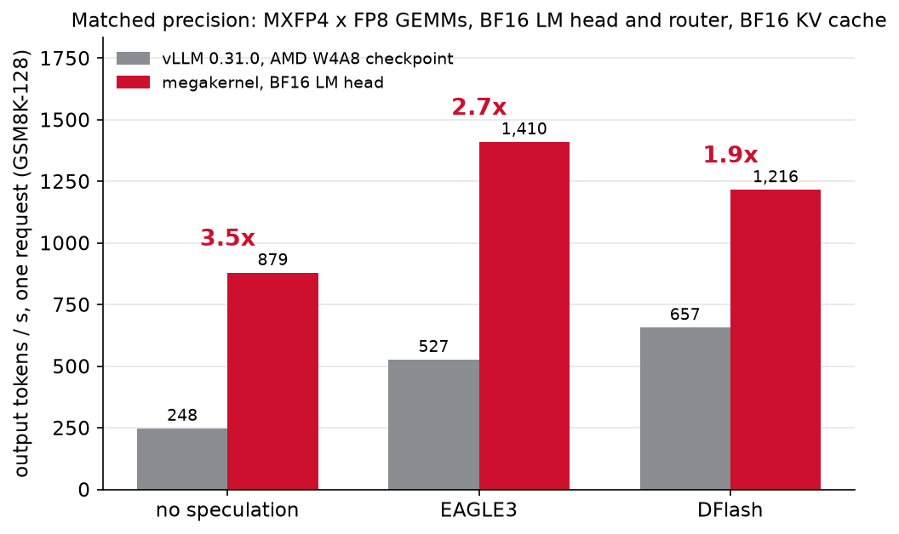
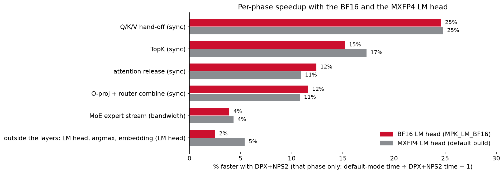

# GPT-OSS-120B: the megakernel and vLLM at matched precision (MI355X, Oct 18 2026)

At matched precision, both on vLLM 0.31.0, the megakernel serves GSM8K-128 at **879 / 1410 / 1215 tok/s** (no
speculation / EAGLE3 / DFlash) and vLLM at **248 / 527 / 657 tok/s**: **3.5x / 2.7x / 1.85x**. Here "matched" means
vLLM runs AMD's MXFP4 x FP8 checkpoint and the megakernel runs the checkpoint's BF16 LM head instead of its own
MXFP4 one. Against stock vLLM (BF16 attention and LM head, 268 / 651 / 784 tok/s) the ratios are 3.3x / 2.2x /
1.55x. The BF16 LM head costs the megakernel 12% in no-speculation decode (it reads 1.19 GB per token instead of
0.32 GB) and 5% / 3% with speculation, where one LM-head pass serves several tokens.

On GSM8K in gpt-oss's chat format every engine and precision scores 94.8-95.4%, and on MMLU-Pro in chat format
(1,400 questions) the megakernel scores 74.4% with its MXFP4 LM head and 73.5% with the BF16 one, against 73.2% for
stock vLLM and 74.9% for vLLM W4A8 (section 3a). On vLLM's raw 5-shot completions evaluator, MXFP4 attention weights
cost both engines: vLLM W4A8 43.8% and the megakernel 42.8% (41.6% with the BF16 LM head), against 49-61% for BF16
attention weights under various engine settings. That is the only format where precision shows, and FP6 or FP8
attention weights recover it (section 4). The speculative builds score lower on that evaluator because their
attention is split over fewer KV chunks, not because of speculation (section 3b).

## 1. Precision of each part

| Part | Megakernel, default build | Megakernel, `MPK_LM_BF16` build | vLLM 0.31.0, stock checkpoint | vLLM 0.31.0, AMD W4A8 checkpoint |
|---|---|---|---|---|
| q/k/v/o projections | MXFP4 weights (quantized from the checkpoint's BF16), FP8 E4M3 inputs | same as default | BF16 x BF16 | MXFP4 weights x FP8 E4M3 inputs |
| MoE experts | MXFP4 weights (checkpoint) x FP8 E4M3 inputs | same as default | MXFP4 weights x BF16 inputs (Triton W4A16) | MXFP4 weights x FP8 E4M3 inputs (AITER) |
| Router | BF16 | BF16 | BF16 | BF16 |
| LM head | MXFP4 weights (quantized from BF16) x FP8 E4M3 inputs | **BF16 x BF16** | BF16 x BF16 | BF16 x BF16 |
| KV cache | BF16 | BF16 | BF16 | BF16 (`--kv-cache-dtype bfloat16`) |
| FP8 input scales | dynamic E8M0 block scales (32 or 128 values per block, by GEMM) | same as default | - | static, one per tensor (from the checkpoint) |

MXFP4 is E2M1 values with one E8M0 scale per 32 weights. The W4A8 checkpoint is
`amd/gpt-oss-120b-w-mxfp4-a-fp8-kv-fp8-fp8attn-no_lmhead_router` (Quark: weights FP4 per group of 32 with E8M0 scales,
inputs FP8 E4M3 per tensor, static; router and `lm_head` excluded). It also asks for FP8 attention (KV cache and
softmax); we run it with a BF16 KV cache, as the megakernel. What still differs at "matched" precision: the scale of
the FP8 inputs (dynamic per 32 or 128 values in the megakernel, static per tensor in vLLM), and the attention kernels.

The `MPK_LM_BF16` build streams the checkpoint's BF16 LM-head rows as K-major 1 KiB records through
`v_mfma_f32_16x16x32_bf16`, 23 records in flight per wave (the megakernel repository, branch `gpt-oss-120b-mi355x`). Its
single-request
decode costs 1.286 ms per token against 1.147 for the MXFP4 head on the same GPU (1k prompt, 256 tokens), the
expected +0.14 ms for 0.87 GB more per token at the LM head's streaming rate; its output equals the MXFP4 head's
for the first 107 tokens of that prompt, then a near-tie flips. DFlash's draft LM head stays MXFP4 (it only proposes
tokens; the target's BF16 head verifies every one).

## 2. Speed: GSM8K-128

128 GSM8K test questions (openai/gsm8k, `shuffle(seed=42)`, first 128), the prompt token ids of
`engine_adapters/vllm/scripts/data/gsm128_ref_ns.json`, greedy, 256 tokens, EOS ignored, one request at a time.

| Config | vLLM stock | vLLM W4A8 | Megakernel, MXFP4 LM head | Megakernel, BF16 LM head | BF16 head / vLLM W4A8 | BF16 head / vLLM stock |
|---|---|---|---|---|---|---|
| No speculation | 268 | 248 | 994 | 879 | 3.5x | 3.3x |
| EAGLE3 | 651 (5 drafts); 582 (3) | 527 (5 drafts); 506 (3) | 1484 | 1410 | 2.7x | 2.2x |
| DFlash (7 drafts) | 784 | 657 | 1258 | 1215 | 1.85x | 1.55x |

Output tokens per second, pooled over the 128 questions. The EAGLE3 ratios use vLLM's faster setting (5 drafts).



- **Megakernel:** served through `vllm serve` (vLLM 0.31.0, the original `fleet_mk` plugin, one launch per request)
  on one MI355X in DPX+NPS2. Each configuration ran BF16 head, MXFP4 head, BF16 head in one session (DFlash: one
  BF16 run, then BF16 and MXFP4 20 minutes later); the BF16 column is the mean of its two runs (878 and 880, 1404 and
  1416, 1220 and 1211). On vLLM 0.27.1 the same sweep read 874 / 1395 / 1207 (BF16 head) and 995 / 1469 / 1246
  (MXFP4 head). EAGLE3 is the LMSYS head
  (`lmsys/EAGLE3-gpt-oss-120b-bf16`, FP8 in the kernel) with a 6-token verify, up to 5 chained drafts and a
  confidence gate. DFlash is the z-lab drafter with an 8-token block. Every served answer equals the kernel's own
  output (streamed == kernel arena, 128/128 in all nine runs, none restarted). These are the GSM8K-length builds of
  the README's published column (466-token arena; published 991 / 1473 / 1247), not its
  32K builds (969 / 1454 / 1223). The MXFP4 runs are token-identical to the published references. The BF16 head's
  outputs are new: over the checked tokens (100 without speculation, 256 with), 14 / 2 / 1 of its 128 answers match
  the MXFP4 references.
- **vLLM:** the offline engine on one MI355X in SPX/NPS1, with the SemiAnalysis MI355X settings (AITER on, inductor
  graph partition, `fuse_rope_kvcache`). Decode time is the GPU-timeline step period from `vllm_step_timing.py`:
  decode steps x the median step, the first token excluded. EAGLE3 is NVIDIA's `nvidia/gpt-oss-120b-Eagle3-v3`, DFlash
  `z-lab/gpt-oss-120b-DFlash`. Per step, stock / W4A8: no speculation 3.72 / 4.01 ms; EAGLE3 (5 drafts) 3.78 tokens
  in 5.80 ms / 3.67 in 6.97; DFlash 4.43 tokens in 5.65 ms / 4.20 in 6.40. W4A8 makes vLLM slower at one request (the
  target's step 4.00 ms against 3.72 without speculation); which kernels account for it was not measured.
- vLLM 0.27.1 (the version the README's "published" column compares against) measured 268 / 562 / 615. vLLM 0.31.0
  is faster with speculation (shorter verify and draft steps, same tokens per step); the megakernel's speed does not
  depend on the vLLM version (README, section 4).

## 2a. Per phase: the BF16 LM head, and DPX+NPS2 against the default mode

The phase recorder over the 1,024 generated tokens of a 982-token prompt (one request, the megakernel outside vLLM),
mean over all workers, scaled to each run's plain decode time; us per token. The same code and output in both modes
(the default mode as deployed: stock SPX+NPS1, without the per-die copies the stock driver cannot place). Fleet
repository, `scripts/nps2/blog/`: `run_dpx.sh phase`, `run_default.sh phase`, `blog_tab.py`.

| Phase | Default, MXFP4 head | DPX+NPS2, MXFP4 head | Default, BF16 head | DPX+NPS2, BF16 head |
|---|---|---|---|---|
| Between layers | 78.1 | 76.0 | 77.4 | 76.4 |
| Gate wait + QKV | 50.0 | 49.7 | 51.2 | 48.9 |
| QKV epoch (the Q/K/V hand-off) | 35.3 | 28.3 | 35.1 | 28.2 |
| Attention + merge | 43.3 | 41.4 | 43.3 | 41.6 |
| Attention release | 121.3 | 109.4 | 123.1 | 109.5 |
| O-proj + router | 218.7 | 197.4 | 220.4 | 197.4 |
| TopK | 148.3 | 126.4 | 145.7 | 126.5 |
| MoE | 327.3 | 314.0 | 329.6 | 317.3 |
| Layer gate | 56.1 | 52.0 | 57.3 | 52.6 |
| Outside the layers (LM head, argmax, embedding) | 80.5 | 76.4 | 211.9 | 206.6 |
| Token (plain decode) | 1,159 | 1,071 | 1,295 | 1,205 |

The BF16 head changes the last phase only: +131 us per token in the default mode and +130 in DPX+NPS2, the time to
stream 0.87 GB more per token. No phase inside the layers moves by more than 3.3 us. DPX+NPS2's gain per phase is
the same with either head (Q/K/V hand-off 25%, TopK 15-17%, attention release and O-proj combine 11-12%, MoE stream
4%) except outside the layers: 5.4% faster with the MXFP4 head, 2.5% with the BF16 head, where most of that phase is
then one long stream, the kind of work locality speeds up least (like the MoE stream). The whole token gains 8.2%
with the MXFP4 head and 7.5% with the BF16 head.



Critical path of pass 1500 (~1.5K context): a layer takes 31.12 us in the default mode with either head, and 29.69 us
(MXFP4 head) or 29.47 us (BF16 head) in DPX+NPS2. 86% (MXFP4) and 83% (BF16) of the difference is data movement
(MoE, O-proj, attention), the rest synchronization. The blog's numbers on the latest code, with how to reproduce each,
are in [BLOG_REPRODUCTION.md](BLOG_REPRODUCTION.md).

## 3. Accuracy: GSM8K test, all 1,319 questions

| Engine | Checkpoint, settings | Chat: 0-shot, reasoning low, up to 4,096 tokens | vLLM's evaluator: 5-shot completions, 256 tokens |
|---|---|---|---|
| vLLM 0.31.0 | stock; default settings, one request at a time | 95.4% | 56.1% |
| vLLM 0.31.0 | stock; AITER settings, BF16 KV cache, 64 at a time | 95.2% | 49.1% |
| vLLM 0.31.0 | W4A8 (section 1); AITER settings, BF16 KV cache, 64 at a time | 94.9% | 43.8% |
| Megakernel | default build, no speculation, one request at a time | 95.3% | 42.8% |
| Megakernel | default build, EAGLE3 | 94.8% | 39.3% |
| Megakernel | default build, DFlash | 95.3% | 35.5% |
| Megakernel | `MPK_LM_BF16` build (the checkpoint's BF16 LM head), no speculation, one request at a time | 95.2% | 41.6% |

Greedy, a freshly started server per run, no failed request. Pairs that differ only in precision, question by
question: vLLM W4A8 against the stock checkpoint at the same settings, chat -0.2 points (McNemar p = 0.77), 5-shot
-5.3 (p = 0.005); the megakernel against stock vLLM one request at a time, chat -0.1 / -0.6 / -0.1 (p = 1.0 / 0.29 /
1.0), 5-shot -13.3 / -16.8 / -20.6 (p < 0.001). The same stock checkpoint scores 56.1% or 49.1% on the 5-shot
evaluator depending on vLLM's settings and batching: this evaluator's score moves with any numeric change (section 4).

The BF16 LM head does not move the score, as the emulation in section 4 predicted: question by question against the
MXFP4 head, 5-shot -1.1 points (231 questions only the MXFP4 head gets right, 216 only the BF16 head; p = 0.51) and
chat -0.1 points (12 against 11, p = 1.0). At matched precision on both sides, the BF16-head megakernel against vLLM
with the W4A8 checkpoint, the 5-shot difference is -2.2 points (p = 0.21). The `MPK_LM_BF16` row ran through the original
`fleet_mk` plugin in the default mode (section 5; the megakernel repository's branch `gpt-oss-120b-mi355x`, built
with `MPK_HOST_STOP=1`).
The same route with the default build reproduces the provider row above question by question: 1,317 of the 1,319
5-shot completions are identical and the same 564 questions are right. The chat prompts carry the date (vLLM writes
"Current date" into gpt-oss's system message), so the BF16 chat run pins it to the Oct 17 date of the other chat runs
(`VLLM_SYSTEM_START_DATE=2026-10-17`); vLLM 0.27.1, which serves that route, renders gpt-oss's chat prompts
token-identically to 0.31.0.

## 3a. Accuracy: MMLU-Pro, chat format

A fixed sample of 1,400 test questions of TIGER-Lab/MMLU-Pro, 100 from each of its 14 categories
(`random.Random(42).sample` per category over the questions in `question_id` order; `prep_mmlupro.sh`), up to ten
options each. The user message is OpenAI simple-evals' multiple-choice template with as many letters as the question
has options; reasoning effort low, greedy, up to 4,096 tokens; the score is the last `Answer: X` in the final answer
(`mmlupro_eval.py`). Every run's prompts carry the same date (2026-10-18).

| Engine | Checkpoint, settings | Accuracy | No answer |
|---|---|---|---|
| vLLM 0.31.0 | stock; AITER settings, BF16 KV cache, 64 at a time | 73.2% | 0.0% |
| vLLM 0.31.0 | W4A8; AITER settings, BF16 KV cache, 64 at a time | 74.9% | 0.4% |
| Megakernel | default build (MXFP4 LM head), no speculation, one request at a time | 74.4% | 0.6% |
| Megakernel | `MPK_LM_BF16` build, no speculation, one request at a time | 73.5% | 0.6% |

Question by question against stock vLLM: the megakernel +1.1 points with the MXFP4 LM head (66 questions only stock
gets right, 82 only the megakernel; p = 0.22) and +0.3 with the BF16 head (p = 0.81); vLLM W4A8 +1.6 (p = 0.047). The
two LM heads differ by 0.9 points (p = 0.30). The megakernel's precision shows no measurable loss in this format.
GPQA-Diamond was not run: the dataset is gated.

## 3b. Why the speculative builds score lower on the 5-shot evaluator

Speculation does not change what the target computes. With drafting off (`MPK_SPEC_K=0`, the same binaries) the EAGLE3
and DFlash builds reproduce their drafting outputs token for token on all 128 GSM8K-128 questions (256 tokens each).
What differs is attention. The speculative builds' multi-token engine splits each request's attention over 31 / slots
KV chunks, 5 for EAGLE3 (6 slots) and 3 for DFlash (8 slots), against 8 for the single-token build at these lengths.
Forced to 5 chunks (`CK_FMHA_NUM_KV_CHUNKS=5`) the single-token build produces exactly the EAGLE3 build's tokens, and
forced to 3 exactly the DFlash build's (128/128 each). So, as far as these checks reach, section 3's 5-shot rows
measure the single-token build at 8, 5 and 3 chunks: 42.8%, 39.3% and 35.5%.

A different split only reorders the attention sums (an online softmax per chunk, then the merge), yet nearly every
5-shot completion changes (8 and 14 of the 1,319 stay identical), most within their first ten characters, where the
model's choices are near-ties, and the score falls with fewer chunks.
Against 8 chunks, 5 chunks lose 250 questions and gain 205 (p = 0.04), and 3 chunks lose 274 and gain 178 (p < 0.001).
Most lost questions are completions that reach the 256-token limit without a final answer (209 of the 250, 221 of the
274), and the mean completion grows from 214 to 230 tokens. The chat format does not move (94.8-95.3%).

Why fewer chunks lower this score is open. Teacher-forced perplexity on 2,048 WikiText-2 tokens points the other way:
from position ~720 on, fewer chunks give the same or lower NLL (3 chunks: -0.08 nats per token overall, block t = -6.5
over 32-token blocks). But that perplexity mode's NLL rises with position (2.4 nats over the first 128 tokens, 6.0 past
720), which no sound model shows, so it does not settle the question. Until it is understood we make no claim that
speculation is lossless in accuracy for GPT-OSS on this evaluator; it is exact with respect to the target build at
the same attention split.

## 4. What costs the 5-shot score: the megakernel's precision emulated in stock vLLM

Stock vLLM 0.31.0 with `engine_adapters/vllm/scripts/eval/fleetq_plugin`, which round-trips chosen weights or GEMM
inputs through the megakernel's own quantizers (bit-identical, `test_fq.py`); eager, 64 requests at a time, all
1,319 questions of the 5-shot evaluator.

| What is quantized as in the megakernel | Accuracy | vs control |
|---|---|---|
| Nothing (control; an identical second run) | 57.0% (60.7%) | (+3.7, p = 0.016) |
| q/k/v/o and LM head MXFP4 | 38.7% | -18.4 |
| q/k/v/o and LM head MXFP4, FP8 inputs (the megakernel's precision) | 36.8% | -20.2 |
| q/k/v/o MXFP4 | 39.7% | -17.3 |
| q, k, v MXFP4 (o BF16) | 50.4% | -6.6 |
| k and v MXFP4 | 52.6% | -4.4 |
| q MXFP4 | 59.6% | +2.6 (p = 0.14) |
| o MXFP4 | 66.9% | +9.9 |
| LM head MXFP4 | 49.2% | -7.8 |
| FP8 inputs only | 62.9% | +5.9 |
| The megakernel's precision with a BF16 LM head | 34.8% | -22.2 |
| The megakernel's precision with an MXFP8 LM head | 37.2% | -19.9 |
| q/k/v/o FP6 (E2M3, E8M0 per 32) | 62.6% | +5.6 |
| q/k/v/o MXFP8 (E4M3, E8M0 per 32) | 62.1% | +5.1 |
| q/k/v/o FP6, LM head MXFP4, FP8 inputs | 59.4% | +2.4 (p = 0.17) |

- The attention projections are the cost: MXFP4 q/k/v/o together take 17-20 points. In FP6 or FP8 the score is back
  in the control's range, even with the MXFP4 LM head and FP8 inputs.
- With MXFP4 attention weights the LM head's precision does not matter (BF16 34.8%, MXFP4 36.8%, MXFP8 37.2%).
- This evaluator magnifies small numeric changes: two identical control runs differ by 3.7 points, and single parts
  move the score by up to 10 points either way. The chat format shows no loss for any precision here (section 3).

## 5. Environment

| | Megakernel speed (sections 1-2) | Megakernel accuracy (section 3) | vLLM speed and accuracy, emulation |
|---|---|---|---|
| Node | one MI355X node, the GPU at HIP devices 12 and 13; section 2a's default-mode runs: one GPU of a second node | the first node | the second node, MI355X GPUs 0-3, one per run |
| Partition | DPX+NPS2 (all 8 GPUs); section 2a's default-mode runs: SPX/NPS1 | DPX+NPS2 | SPX/NPS1 (all 8 GPUs) |
| Container | served: `vllm/vllm-openai-rocm:v0.31.0` (as on the right); section 2a: `vllm/vllm-openai-rocm:v0.27.1`, for its ROCm 7.2.3 runtime only (no vLLM in those runs) | `vllm/vllm-openai-rocm:v0.31.0` | `vllm/vllm-openai-rocm:v0.31.0`: vLLM 0.31.0+rocm723, ROCm 7.2.3, PyTorch 2.13.0, Triton 3.8.0, AITER 0.1.23, Transformers 5.17.0, Python 3.12.14 |
| Megakernel compiler | ROCm 7.0.0 hipcc (AMD clang 20.0.0git, roc-7.0.0 25314) | the providers: ROCm 7.0.0 (`FLEET_MPK_ROCM_ROOT`) | - |

Both nodes: Linux 6.8.0-136-generic, the stock amdgpu driver 6.16.13 (srcversion `CEAB5639AA71CAA0934A209`), host
ROCm 7.2.0, GPU power cap 1400 W. The megakernel's device code is built by ROCm 7.0 and runs on the container's
ROCm 7.2.3 runtime. The megakernel accuracy rows are this tree's providers (default builds), and the stock vLLM rows
run one request at a time are the README's (section 4): its 5-shot run on one DPX partition of the megakernel's GPU,
its chat run on the second node.

The `MPK_LM_BF16` accuracy rows, the default build's 5-shot reproduction (section 3) and the megakernel's MMLU-Pro
rows (section 3a) ran on the second node, GPUs 0 and 1, in SPX/NPS1 on the stock driver, through the original
`fleet_mk` plugin in `vllm/vllm-openai-rocm:v0.27.1`. The code is the megakernel repository's branch
`gpt-oss-120b-mi355x`, built by ROCm 7.0 as above with `MPK_HOST_STOP=1`. Without that flag a launch decodes on to the request's
`max_tokens` after vLLM has stopped it; the answers are the same, only slower. The sessions ran one at a time: ending
a GPU process on that node hung another session's launch in flight. The stock vLLM MMLU-Pro rows ran on the same
GPUs just before.

## 6. Reproduce

vLLM, GSM8K-128 (four GPUs of one node in SPX/NPS1, one configuration per GPU; about 10 minutes):

```bash
S=aitermk/engine_adapters/vllm/scripts/vllm_baseline
D=<dir>/z-lab_gpt-oss-120b-DFlash; E=<dir>/nvidia_gpt-oss-120b-Eagle3-v3
# stock checkpoint
MODEL=<dir>/gpt-oss-120b DFLASH=$D EAGLE3=$E TAG=v31 OUT=vllm_gsm128 bash $S/gsm128_vllm_baseline.sh
# the megakernel's GEMM precision
MODEL=<dir>/gpt-oss-120b-w-mxfp4-a-fp8-kv-fp8-fp8attn-no_lmhead_router EXTRA_ENV=KV_DTYPE=bfloat16 \
  DFLASH=$D EAGLE3=$E TAG=w4a8 OUT=vllm_gsm128 bash $S/gsm128_vllm_baseline.sh
```

`vllm_step_timing.py` is the per-step GPU timer (vLLM's model runners V1 and V2, no vLLM change) and
`gsm128_vllm_summary.py` the table; a 16-question run (`N=16`) reproduced the 128-question step times within 1%.

vLLM accuracy (README, section 4; tools in `aitermk/engine_adapters/vllm/scripts/eval/`): the two rows at 64
requests at a time use `geval_run.py --mode stock --model <checkpoint> --conc 64 --stock-args='--kv-cache-dtype
bfloat16 --max-model-len 8192'` with the AITER settings in the environment (`VLLM_ROCM_USE_AITER=1`; without it vLLM
runs the W4A8 checkpoint's MoE in an emulated path) and `--eval chat` for the chat format. The emulation rows:
`PYTHONPATH=aitermk/engine_adapters/vllm/scripts/eval/fleetq_plugin` and `--plugins fleetq` with `FQ_W=1`
(weights; `FQ_W_MODS` picks `qkv`, `o`, `lm`, joined with `+`; `FQ_QKV_PARTS=q+k+v` a subset; `FQ_ATT_FMT` /
`FQ_LM_FMT` = `mxfp4` | `fp6` | `fp8`; `FQ_Q_FMT` / `FQ_KV_FMT` / `FQ_O_FMT` per projection) and `FQ_A=1` (FP8 inputs;
`FQ_A_LM=0` leaves the LM head's input in BF16); `test_fmt.py` checks the formats.

Megakernel with the BF16 LM head through this tree's provider path:
`CONFIGS="ns_bf16 e3_bf16 df8_bf16" bash aitermk/engine_adapters/vllm/scripts/gpt_oss_build_and_repro.sh` serves the BF16-LM-head builds
(exports from the fleet repository's `LM=bf16 ARENA=466 scripts/nps2/aitermk/exp_run.sh ns|e3|df8`); on Oct 19 it
served 877 / 1400 / 1212 tok/s, every answer token-identical to the Oct 18 serves. Through the megakernel's own plugin: the
megakernel repository's branch `gpt-oss-120b-mi355x`, built with
`MPK_EXTRA_FLAGS=...,-DMPK_LM_BF16` and run with
`MPK_LM_BF16=1 MPK_LM_PF0=0 MPK_LM_PIPE_S=0 MPK_LM_HEAD_GROUP_PIPELINE=0 MPK_LM_HEAD_KMAJOR=0
MPK_LM_HEAD_WAVE_TILE_DMA=0` (the MXFP4 head's pipelines; the build stops with an error if they are left on).
`scripts/nps2/fair/fair_t1.sh` there is the served sweep of section 2; for vLLM 0.31.0, point the lane at a
`vllm/vllm-openai-rocm:v0.31.0` container. The original plugin imports mirage's extension, so that container also
needs mirage's libz3 on the library path (a file in `/etc/ld.so.conf.d/` naming its directory, then `ldconfig`) and
`pip install graphviz`; without them the engine fails at start with "libz3.so.5.1: cannot open shared object file".
This tree's provider path needs neither. Section 2a: `scripts/nps2/blog/` there (`run_dpx.sh phase`,
`run_default.sh phase`, `blog_tab.py`; see [BLOG_REPRODUCTION.md](BLOG_REPRODUCTION.md)).

MMLU-Pro and the paired statistics (`aitermk/engine_adapters/vllm/scripts/eval/`): `prep_mmlupro.sh` downloads
the test split and writes the 1,400-question sample (`mmlupro_test.jsonl`, SHA-256
`12a1b87c9443a3dca831243f08cd9863ae643a1a60c999e8f6a49f42fb40e103`); stock vLLM runs it with
`geval_run.py --eval mmlupro --datasets <the directory holding mmlupro_test.jsonl>` and the settings above;
`pstats.py` prints every paired comparison of sections 3-3b (exact McNemar; point `MK_EVAL_ROOT` and `GEVAL_RESULTS`
at the run directories); `render_chk.py` renders gpt-oss chat prompts as vLLM's chat endpoint does, to check that two
vLLM images agree. The megakernel's accuracy runs of section 3a and the BF16 rows: the megakernel repository's
`scripts/nps2/fair/eval/` (branch `gpt-oss-120b-mi355x`; `serve_eval.py` serves one session's evaluators behind
`vllm serve`, `mk_eval_def.sh` starts a session, `seq_ev3.sh` runs the sessions one at a time).

